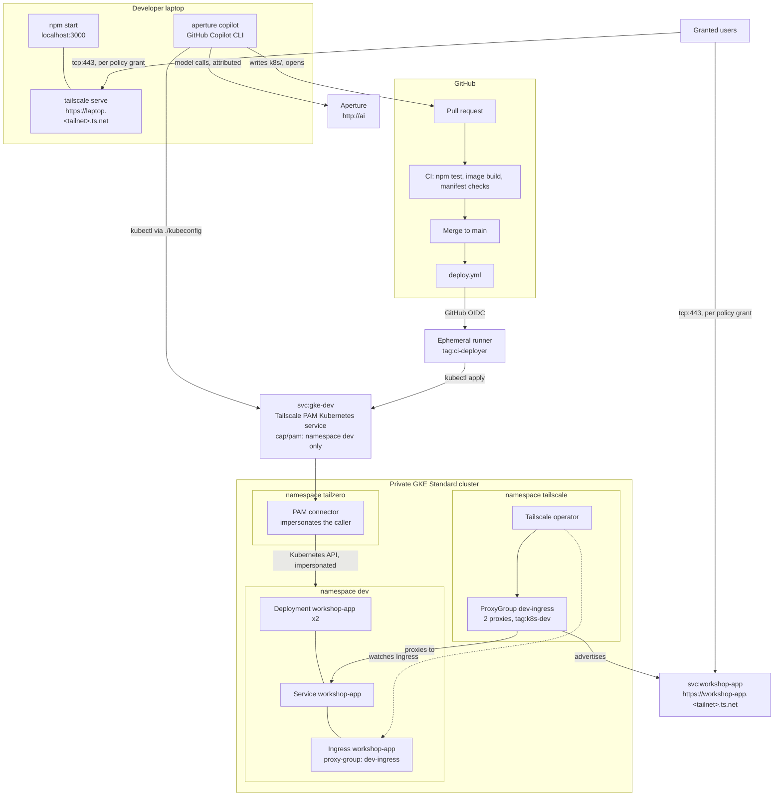

# Agentic-Aided Deployment Beyond Localhost

A developer has a small Node.js app that works on their laptop. They know nothing about Kubernetes. The platform team has given them one namespace in a private GKE cluster and a kubeconfig that reaches it only through Tailscale. Their agent, GitHub Copilot CLI launched through the Aperture CLI, writes the manifests and opens the pull request. GitHub Actions deploys it through Tailscale PAM, and the Tailscale Kubernetes operator puts it on the tailnet.

Nobody in this story holds a Kubernetes credential, a cloud credential, a Tailscale auth key, or a model API key. Tailscale identity is the credential at every step, and every access change is a pull request.

## The story

1. **Localhost.** `npm start`. The app runs on the developer's laptop.
2. **Share it.** `tailscale serve --bg 3000` publishes it at `https://<laptop>.<tailnet>.ts.net`. A pull request in the policy repository lets the team in.
3. **Ship it with an agent.** `aperture copilot` starts Copilot CLI with Aperture as its model gateway, so every model call is attributed to the developer's tailnet identity. The agent reads the platform contract, writes `k8s/`, checks the namespace through PAM, and opens a pull request.
4. **Deploy.** Merging runs `deploy.yml`. The runner joins the tailnet as an ephemeral `tag:ci-deployer` with GitHub OIDC and applies `k8s/` through the Tailscale PAM Kubernetes service `gke-dev`, which only allows namespace `dev`.
5. **On the tailnet.** The agent's `Ingress` is served by the operator's `dev-ingress` ProxyGroup as the Tailscale Service `svc:workshop-app`, at `https://workshop-app.<tailnet>.ts.net`, from two proxy replicas.
6. **Team access.** A second policy pull request grants the team the dev-cluster Service. Reverting it revokes access.

The app is plain Node.js and contains no Tailscale code. Reachability, identity, and access all come from the tailnet.

## Architecture



## Security boundaries

- The cluster's IP control-plane endpoint is disabled. The platform team uses the IAM-gated DNS endpoint; developers and CI reach the API only through the PAM service.
- The developer and CI hold Kubernetes `edit` in `dev` only, bound to the identities the connector impersonates: the developer's login and `tag:ci-deployer@service.border0.com`.
- The `tailscale.com/cap/pam` grant restricts Kubernetes requests to `namespaces: ["dev"]` before RBAC is evaluated.
- GitHub Actions logs in with GitHub OIDC, scoped by `workflow_ref` to `deploy.yml` on `main`. No secret is stored in GitHub.
- Copilot CLI runs in offline BYOK mode against Aperture. It needs no GitHub Copilot sign-in and no model key; Aperture authorizes the developer's tailnet identity.
- The app's identity card comes from `Tailscale-User-*` headers that Tailscale Serve and the operator's Ingress add. Neither the laptop nor the cluster exposes the app any other way.
- Tailscale Funnel is not used.

## What you need

- A tailnet where you are an Admin or Owner, with:
  - HTTPS certificates enabled (**DNS → HTTPS Certificates**).
  - Tailscale PAM enabled (**Settings → PAM**).
  - An Aperture instance tagged `tag:aperture`, reachable at `http://ai` (the launcher's default; any other hostname works with `--endpoint`).
  - A second user, for the access steps.
- A Google Cloud project with the GKE and Compute Engine APIs enabled, and `gcloud` logged in with permission to create clusters and networks.
- A GitHub account with Actions enabled.
- Node.js 24, `kubectl`, `gh`, `terraform`, and `gcloud` installed locally.
- The [Aperture launcher](https://github.com/tailscale/aperture-cli) v0.1.0 or later, and GitHub Copilot CLI:

  ```bash
  curl -fsSL https://raw.githubusercontent.com/tailscale/aperture-cli/main/install.sh | APERTURE_INSTALL_DIR=$HOME/.local/bin sh
  npm install -g @github/copilot
  ```

  Running `aperture` with no arguments and choosing **GitHub Copilot** also offers to install Copilot CLI.

## Set up the platform

These steps play the platform team. Do them once, in order.

### 1. Fork this repository

```bash
gh repo fork <upstream-owner>/agentic-aided-deployment-workshop --clone
cd agentic-aided-deployment-workshop
```

Keep the fork public: GitHub then makes the container images that `deploy.yml` pushes public too, so the cluster pulls them without credentials.

### 2. Create the policy repository

Follow [`policy/README.md`](policy/README.md). It creates a private repository from `policy/`, has you fill in two login names, and applies the first version by hand.

### 3. Build the infrastructure

Terraform builds the cluster, the Tailscale operator and its ingress ProxyGroup, the PAM connector and Kubernetes service, the trust credentials, and the developer namespace. It reads two admin credentials from the environment:

- `TAILSCALE_API_KEY`: an API access token for the tailnet (**Settings → Keys**).
- `BORDER0_TOKEN`: a Tailscale PAM service-account token. Under **Settings → PAM → Service accounts**, add a service account with the **Member** role, then create a token for it. Tailscale PAM is managed through the [Border0 Terraform provider](https://tailscale.com/docs/privileged-access-management/how-to/manage-resources-terraform).

```bash
cd infra
cp terraform.tfvars.example terraform.tfvars
```

Fill in `terraform.tfvars`:

- `gcp_project`, `tailnet` (**Settings → General**), and `developer_login` (your login on the **Users** page).
- `name`: a prefix for the cluster, network, and connector. Keep the default unless you share the GCP project with others.
- `github_repo` and `policy_repo`, as `owner/name`.
- `github_repo_subject_prefix` and `policy_repo_subject_prefix`. GitHub signs OIDC tokens with immutable owner and repository IDs, so read each prefix from GitHub instead of typing it:

  ```bash
  gh api repos/<owner>/agentic-aided-deployment-workshop/actions/oidc/customization/sub -q .sub_claim_prefix
  gh api repos/<owner>/agentic-aided-deployment-policy/actions/oidc/customization/sub -q .sub_claim_prefix
  ```

Then:

```bash
export TAILSCALE_API_KEY=...
export BORDER0_TOKEN=...
terraform init
terraform apply -target=google_container_cluster.this -target=google_container_node_pool.this
terraform apply
```

The first apply creates the cluster so the Kubernetes and Helm providers have an endpoint. If it fails with `does not have enough resources available`, the zone is out of capacity: run it again. The second apply creates:

- **Network:** a VPC with Cloud NAT and a private GKE Standard cluster with two nodes. The Tailscale operator needs privileged pods, so GKE Autopilot does not work.
- **Tailscale operator:** an OAuth client tagged `tag:k8s-operator`, the operator Helm release, and the `dev-ingress` ProxyGroup with two `tag:k8s-dev` proxies.
- **Tailscale PAM:** the connector, its token, and the Kubernetes service `gke-dev` with impersonation on. The connector exchanges its token for its own Tailscale auth key.
- **Trust credentials:** deploy, policy test, and policy apply, all GitHub OIDC.
- **Developer namespace:** `dev` and its `edit` RoleBinding for the developer and `tag:ci-deployer`.

You should see `<name>-operator`, `dev-ingress-0`, `dev-ingress-1`, and the connector on the **Machines** page, and `svc:gke-dev` on the **Services** page.

### 4. Set the repository variables

```bash
gh variable set TS_DEPLOY_CLIENT_ID --body "$(terraform -chdir=infra output -raw deploy_client_id)"
gh variable set TS_DEPLOY_AUDIENCE  --body "$(terraform -chdir=infra output -raw deploy_audience)"
```

Set the policy repository's variables as [`policy/README.md`](policy/README.md#repository-variables) describes. All of these are identifiers, not secrets: a token is issued only to a workflow whose OIDC claims match.

### 5. Check developer access

```bash
KUBECONFIG=./kubeconfig kubectl get pods
KUBECONFIG=./kubeconfig kubectl -n kube-system get pods
```

The first returns `No resources found in dev namespace.` The second fails with `no policy rule allows access ... in the "kube-system" namespace`: PAM refuses it before Kubernetes sees it. `./kubeconfig` contains no credentials; your Tailscale identity is the credential.

## Run the story

### Step 1: Localhost

```bash
npm test
HOST=127.0.0.1 npm start
curl http://127.0.0.1:3000/health
```

You should see `{"status":"ok",...}`.

### Step 2: Share it with tailscale serve

In another terminal:

```bash
tailscale serve --bg 3000
tailscale serve status
```

Open the `https://<laptop>.<tailnet>.ts.net` address it prints, from another of your devices. The identity card shows your name: Serve adds the `Tailscale-User-*` headers. The teammate can't connect.

To let the team in, open access pull request 1 from [`policy/README.md`](policy/README.md#access-pull-request-1-share-the-laptop) in the policy repository. The pull request runs `action: test`; merging applies it, and the teammate gets in with their own identity.

### Step 3: Ship it with an agent

From the repository root:

```bash
aperture copilot
```

The launcher connects to Aperture at `http://ai`, lists the models Aperture offers, and starts Copilot CLI pointed at the one you pick. Copilot needs no GitHub sign-in, no Copilot plan, and no model key. Every request appears in the Aperture dashboard under your tailnet identity. To skip the menu:

```bash
aperture copilot --model anthropic/claude-sonnet-5.5
aperture copilot --endpoint http://<aperture-hostname> --model anthropic/claude-sonnet-5.5
```

Everything after `--` goes to `copilot` unchanged. `aperture copilot --debug` prints the environment the launcher sets.

Prompt:

> Ship this app to my dev namespace, highly available and reachable on the tailnet. Follow the platform contract, then open a pull request.

The agent reads `.github/copilot-instructions.md`, writes a `Deployment`, `Service`, and Tailscale `Ingress` like `docs/reference/workshop-app.yaml`, commits them on a branch, and opens the pull request with `gh`. It can check the namespace with `KUBECONFIG=./kubeconfig kubectl get all`. Ask it to try `-n kube-system`; PAM refuses.

### Step 4: Deploy

Merge the pull request after CI passes. CI runs the tests, builds the image, and checks `k8s/`. `deploy.yml` then:

1. Builds and pushes `ghcr.io/<owner>/<repo>:<sha>`.
2. Joins the tailnet as an ephemeral `tag:ci-deployer` with GitHub OIDC, using the official [Tailscale GitHub Action](https://github.com/tailscale/github-action).
3. Uses the same `./kubeconfig` the developer has.
4. Substitutes the image into every workload in `k8s/`, applies the manifests through PAM, and waits for the rollout.

The run's last step lists two `workshop-app` pods `Running` and the `workshop-app` Ingress.

### Step 5: The app on the tailnet

```bash
KUBECONFIG=./kubeconfig kubectl get ingress workshop-app
```

When `ADDRESS` shows `workshop-app.<tailnet>.ts.net`, open `https://workshop-app.<tailnet>.ts.net`. The operator created the Tailscale Service `svc:workshop-app`, and both `dev-ingress` proxies advertise it. The identity card shows you again, this time added by the operator's ingress proxy. Delete one of the app pods through `./kubeconfig` and keep reloading: the `Service` sends every request to the remaining replica.

### Step 6: Team access to the dev cluster

Before the change, the teammate's connection to `https://workshop-app.<tailnet>.ts.net` fails. Tailscale drops the traffic before the app sees it, so there is no HTTP 403.

Open access pull request 2 from [`policy/README.md`](policy/README.md#access-pull-request-2-the-dev-cluster-service). Merge it, and the teammate gets in with their own identity. Revert it to revoke access; the app and cluster are untouched.

## Repository protection

Protect `main` in both repositories: require pull requests, an approval, passing checks, and resolved conversations. Disable force pushes. Do not let the agent approve or merge its own change. To require your review of workflows and infrastructure, add a `.github/CODEOWNERS` file naming yourself, for example `* @<your-github-user>`. Pin third-party actions to full commit SHAs before using this outside a workshop.

## Cleanup

```bash
tailscale serve reset
terraform -chdir=infra destroy
```

This removes the cluster, the operator and its proxies, the PAM connector and service, the trust credentials, and `svc:workshop-app`. Remove any leftover `<name>*` machines from the tailnet.

## Troubleshooting

### The Ingress never gets an address

- `KUBECONFIG=./kubeconfig kubectl describe ingress workshop-app` shows the operator's events.
- The `tailscale.com/proxy-group` annotation must be `dev-ingress`, and `ingressClassName` must be `tailscale`.
- The policy's `autoApprovers.services` must map `tag:k8s-dev` to `tag:k8s-dev`, and `tag:k8s-dev` must be owned by `tag:k8s-operator`.

### The ProxyGroup reports `requested tags [tag:k8s-dev] are invalid or not permitted`

The policy was applied after the operator started. Apply the policy; the operator retries on its own.

### The laptop's Serve URL fails with a TLS handshake error

Open it from a different device. On one tested macOS client build, the laptop could not reach its own Serve URL over HTTPS (`tls alert handshake failure`), while other devices on the tailnet reached it normally.

### The Service resolves but connections time out

On some tailnets clients only receive a Service's hosts when a grant also names the hosts' tag. The grant therefore lists both `svc:workshop-app` and `tag:k8s-dev` on `tcp:443`.

### kubectl through PAM is refused

- `Forbidden` naming `tag:ci-deployer@service.border0.com` or your login: PAM let the request through, and RBAC refused it. Check the `pam-edit` RoleBinding.
- `no policy rule allows access ... resource name "..."` inside `dev`: the `cap/pam` Kubernetes rule needs `"resource_names": ["*"]`.
- `failed to download openapi`: client-side validation reads the cluster-scoped `/openapi` path, which a namespace-scoped grant refuses. Apply with `--validate=false`, as `deploy.yml` does.
- Connection refused or timeout: the grant to `svc:gke-dev` is missing, or the device is not on the tailnet.

### The deploy or policy workflow fails with `federated identity invalid` or a 403

The trust credentials no longer match. They are deleted by `terraform destroy` and recreated with new IDs by `terraform apply`, so set the repository variables again after every rebuild. A 403 can also mean the subject prefix in `terraform.tfvars` was typed instead of read from GitHub.

## Workshop runbook

See `docs/RUNBOOK.md` for the on-stage sequence and `docs/SETUP.md` for the rehearsal checklist.
