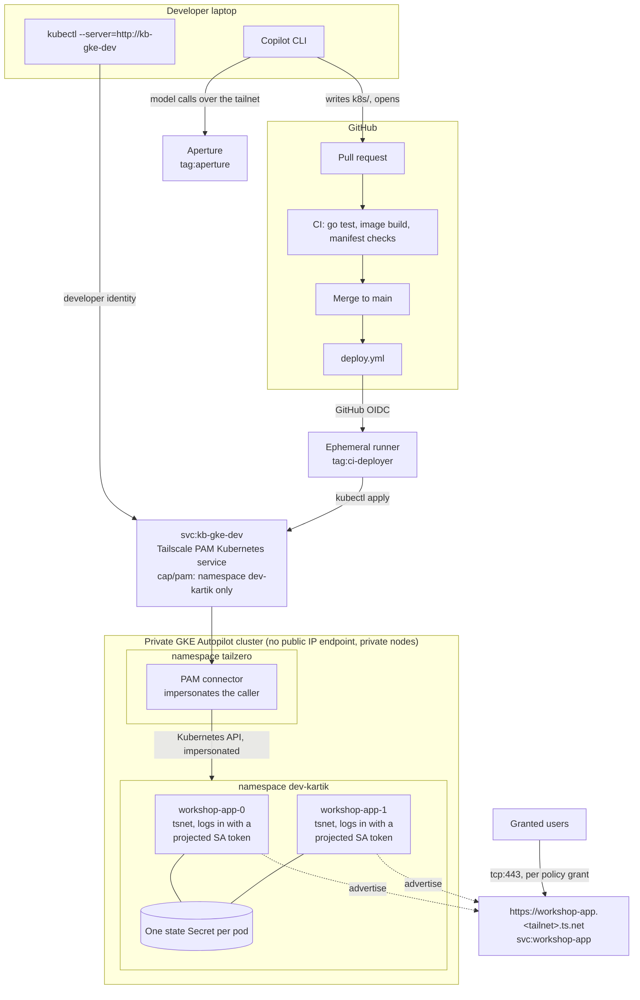

# Agentic-Aided Deployment Beyond Localhost

A developer has an app that runs on their laptop. The platform team has given them one Kubernetes namespace in a private GKE cluster and nothing else. They know nothing about Kubernetes. Their agent, GitHub Copilot CLI, turns the app into manifests and opens a pull request. GitHub Actions deploys it through Tailscale, and the team reaches it at one private HTTPS name served by several replicas.

Nobody in this story holds a kubeconfig, a cloud credential, a Tailscale auth key, or a model API key.

## The story in three acts

**Act 1: localhost to tailnet.** The app is a Go program built with [tsnet](https://tailscale.com/docs/features/tsnet). Run it with `TS_HOSTNAME` set and it joins the tailnet as its own device, with HTTPS, reachable by its owner and nobody else. No Tailscale Service, no server.

**Act 2: the agent ships it.** Copilot CLI runs through [Aperture](https://tailscale.com/docs/aperture), so model access is a tailnet grant instead of an API key. The repository's `.github/copilot-instructions.md` is the platform contract: one namespace, a pre-made ServiceAccount and ConfigMap, no cluster-scoped objects. The agent writes `k8s/` and opens a pull request. It can inspect the namespace through the same Tailscale PAM service the pipeline uses, with the developer's own identity.

**Act 3: production and access.** The merge triggers a deploy. The runner joins the tailnet as an ephemeral `tag:ci-deployer` via GitHub OIDC and runs `kubectl apply` against `http://kb-gke-dev`, a Tailscale PAM Kubernetes service. PAM confines it to `dev-kartik`, and Kubernetes RBAC confines it again. Every replica runs the same binary with `TS_SERVICE=svc:workshop-app`, so one name, `https://workshop-app.<tailnet>.ts.net`, is served by every replica that is up. A second pull request, in the policy repository, grants the team access. Reverting it revokes access.

## Architecture



## Security boundaries

- The cluster's IP control-plane endpoint is disabled. Administrators use the IAM-gated DNS endpoint; developers and CI reach the API only through the PAM service.
- The developer and CI hold Kubernetes `edit` in `dev-kartik` only, bound to the identities the connector impersonates: the developer's login and `tag:ci-deployer@service.border0.com`.
- The `tailscale.com/cap/pam` grant restricts Kubernetes requests to `namespaces: ["dev-kartik"]` before RBAC is evaluated.
- App pods log in with a projected Kubernetes ServiceAccount token, which Tailscale workload identity federation trusts through the cluster's own OIDC issuer. No auth key, Google service account, or IAM binding exists.
- GitHub Actions logs in with GitHub OIDC, scoped by `workflow_ref` to `deploy.yml` on `main`. No secret is stored in GitHub.
- The app's identity card comes from headers that Tailscale Serve adds inside the tsnet process; nothing else can reach that listener.
- Tailscale Funnel is not used. No Kubernetes `Service`, `Ingress`, or load balancer exposes the app.

## Repositories

1. This application repository: app, platform contract, workflows, and `infra/`.
2. A private policy repository, for example [`kbpersonal/agentic-aided-deployment-policy`](https://github.com/kbpersonal/agentic-aided-deployment-policy). `policy/policy.hujson` here is the template. Keep the policy repository private because it contains login names.

## Prerequisites

- A tailnet with HTTPS certificates and Tailscale PAM enabled (**Settings → PAM**), where you are an Admin or Owner.
- An Aperture instance on the tailnet, tagged `tag:aperture`, reachable at `http://ai` (the launcher's default; any other hostname works with `--endpoint`).
- Two Tailscale users for the before/after access demonstration.
- A Google Cloud project with GKE enabled.
- `go`, `kubectl`, and `gh` installed locally. Presenters also need `terraform` and `gcloud`.
- The [Aperture launcher](https://github.com/tailscale/aperture-cli) v0.1.0 or later, and GitHub Copilot CLI (needs Node.js):

  ```bash
  curl -fsSL https://raw.githubusercontent.com/tailscale/aperture-cli/main/install.sh | APERTURE_INSTALL_DIR=$HOME/.local/bin sh
  npm install -g @github/copilot
  ```

  Running `aperture` with no arguments and choosing **GitHub Copilot** also offers to install Copilot CLI.

## Step 1: Act 1 on your laptop

```bash
go test ./...
go run .                              # http://127.0.0.1:3000
TS_HOSTNAME=workshop-app-laptop go run .
```

The second run prints a login URL the first time. Open it, then open the `https://workshop-app-laptop.<tailnet>.ts.net` address the program prints. The identity card shows who you are; the page is reachable only by you, through the `autogroup:self` grant.

## Step 2: Baseline tailnet policy

Copy `policy/policy.hujson` into the private policy repository. Replace `AUTHOR_LOGIN` and `TEAMMATE_LOGIN` with exact login names from **Users**. If the tailnet already has a policy, merge these sections into it. A blanket `* → *` grant would hide the default-deny demonstration, so remove it.

Apply this first version once by hand, in the admin console or with the API. The next step creates the tags' trust credentials, and those need the tags to exist. After that, the policy repository's workflow owns the file.

## Step 3: Infrastructure

Terraform builds everything, including the Tailscale PAM connector and the PAM Kubernetes service. It needs two admin credentials, both read from the environment:

- `TAILSCALE_API_KEY`: an API access token for the tailnet (**Settings → Keys**).
- `BORDER0_TOKEN`: a Tailscale PAM service-account token. Create a service account with the **Member** role under **Settings → PAM → Service accounts**, then create a token for it. Tailscale PAM is managed through the [Border0 Terraform provider](https://tailscale.com/docs/privileged-access-management/how-to/manage-resources-terraform), and this token is its only credential.

```bash
cd infra
cp terraform.tfvars.example terraform.tfvars
# GitHub OIDC subjects use immutable owner and repository IDs; read each prefix with:
gh api repos/OWNER/REPO/actions/oidc/customization/sub -q .sub_claim_prefix
export TAILSCALE_API_KEY=...
export BORDER0_TOKEN=...
terraform init
terraform apply -target=google_container_cluster.this
terraform apply
```

The first apply creates the cluster so the Kubernetes and Helm providers have an endpoint. The second creates:

- **Network:** a VPC with Cloud NAT and a private GKE Autopilot cluster.
- **Tailscale:** four trust credentials (app, deploy, policy test, policy apply) and the `svc:workshop-app` Service.
- **Tailscale PAM:** connector `kb-agentic-workshop` (`border0_connector`), a connector token (`border0_connector_token`), and the Kubernetes service `kb-gke-dev` (`border0_socket`) with impersonation on, using the connector's in-cluster ServiceAccount.
- **Cluster objects:** namespace `dev-kartik` and its RBAC, the `workshop-app` ServiceAccount, the `tailscale` ConfigMap, and the connector's Helm release. The connector exchanges its token for its own Tailscale auth key at startup.

Access to `kb-gke-dev` comes from the `tailscale.com/cap/pam` grant in the policy repository, not from Border0 policies.

## Step 4: Repository variables

```bash
gh variable set TS_DEPLOY_CLIENT_ID  --body "$(terraform -chdir=infra output -raw deploy_client_id)"
gh variable set TS_DEPLOY_AUDIENCE   --body "$(terraform -chdir=infra output -raw deploy_audience)"

P=--repo=OWNER/agentic-aided-deployment-policy
gh variable set TS_TAILNET                $P --body "<tailnet-id>"
gh variable set TS_POLICY_TEST_CLIENT_ID  $P --body "$(terraform -chdir=infra output -raw policy_test_client_id)"
gh variable set TS_POLICY_TEST_AUDIENCE   $P --body "$(terraform -chdir=infra output -raw policy_test_audience)"
gh variable set TS_POLICY_APPLY_CLIENT_ID $P --body "$(terraform -chdir=infra output -raw policy_apply_client_id)"
gh variable set TS_POLICY_APPLY_AUDIENCE  $P --body "$(terraform -chdir=infra output -raw policy_apply_audience)"
```

These are identifiers, not secrets. A token is issued only to a workflow whose OIDC claims match.

## Step 5: Act 2, Copilot CLI through Aperture

From the repository root:

```bash
aperture copilot
```

The launcher connects to Aperture at `http://ai`, lists the models Aperture offers, and starts GitHub Copilot CLI pointed at the one you pick. Copilot needs no GitHub sign-in, no Copilot plan, and no model API key: the launcher runs it in offline BYOK mode, and the attendee's tailnet identity is what Aperture authorizes.

To skip the menu, name the model, and the Aperture host if it isn't `ai`:

```bash
aperture copilot --model anthropic/claude-sonnet-5.5
aperture copilot --endpoint http://<aperture-hostname> --model anthropic/claude-sonnet-5.5
```

Everything after `--` goes to `copilot` unchanged. `aperture copilot --debug` prints the environment the launcher sets.

Prompt:

> Ship this app to production in my namespace, highly available. Follow the platform contract, then open a pull request.

Expect a `k8s/` directory containing a StatefulSet like `docs/reference/workshop-app.yaml`. The agent can check its work with `kubectl --server=http://kb-gke-dev -n dev-kartik get all`. Ask it to try `-n kube-system`; PAM refuses.

## Step 6: Act 3, deploy

Merge the pull request. CI runs the tests, builds the image, and validates that every object in `k8s/` targets `dev-kartik`. `deploy.yml` then:

1. Builds and pushes `ghcr.io/<owner>/<repo>:<sha>`.
2. Joins the tailnet as an ephemeral `tag:ci-deployer` with GitHub OIDC.
3. Points kubectl at `http://kb-gke-dev` with empty credentials.
4. Substitutes the image into every workload in `k8s/`, applies the manifests, and waits for the rollout.

A container package pushed from a public repository's workflow inherits public visibility, so the cluster pulls without credentials. For a private fork, add an image pull secret to the namespace.

Open `https://workshop-app.<tailnet>.ts.net`. The "Served by" field names the replica that answered. Delete the replica serving you (the "Served by" field) with `kubectl --server=http://kb-gke-dev -n dev-kartik delete pod <replica>` and keep reloading. A client stays on one healthy host, so expect one failed request. The StatefulSet recreates the pod with the same tailnet identity from its Secret, and the Service answers again in about 5 to 10 seconds. If the replacement is slow to return, clients move to the other replica.

## Step 7: Default deny, then team access

Before the access change:

- The author opens the Service URL and gets the app.
- The teammate's connection fails. Tailscale drops the traffic before the app sees it, so there is no HTTP 403.
- `kubectl --server=http://kb-gke-dev get pods -n kube-system` fails for everyone.

Open the team-access pull request in the policy repository (see its README). The pull request runs `action: test`; merging applies the exact file. Reload as the teammate. Revert the pull request to revoke access; the app and cluster are untouched.

## Repository protection

Protect `main` in both repositories: require pull requests, an approval, CODEOWNER review for workflows and policy, passing checks, and resolved conversations. Disable force pushes. Do not let the agent approve or merge its own change. Pin third-party actions to full commit SHAs before using this outside a workshop.

## Cleanup

```bash
terraform -chdir=infra destroy
```

This also removes the PAM connector and the `kb-gke-dev` service. Remove any leftover `workshop-app-*` machines.

## Troubleshooting

### Pods are not Ready

`kubectl --server=http://kb-gke-dev -n dev-kartik logs workshop-app-0`.

- `federated identity ... require`: the `tailscale` ConfigMap is missing `TS_CLIENT_ID`/`TS_ID_TOKEN_FILE`, the projected token volume is not mounted, or the pod is not using the `workshop-app` ServiceAccount.
- `failed to exchange JWT`: the app trust credential's issuer must be the cluster's issuer (`https://container.googleapis.com/v1/projects/P/locations/L/clusters/C`), its subject `system:serviceaccount:dev-kartik:workshop-app`, and its audience must equal the projected token's `audience`.
- `service hosts must be tagged nodes`: `TS_TAG` is missing.
- The Service has hosts but never answers: `autoApprovers.services` must map `svc:workshop-app` to `tag:workshop-app`.

### The Service resolves but connections time out

The hosts are `ready`, yet `tailscale debug netmap` on the client lists no `workshop-app-*` peers. Some control-plane paths decide peer visibility from grant destinations that name devices, not Services. The grant therefore lists both `svc:workshop-app` and `tag:workshop-app` on `tcp:443`. The app listens only on the Service address, so the tag destination exposes nothing extra.

### kubectl through PAM is refused

- `Forbidden` naming `tag:ci-deployer@service.border0.com` or your login: PAM let the request through, and RBAC refused it. Check the `pam-edit` RoleBinding.
- Connection refused or timeout: the grant to `svc:kb-gke-dev` is missing, or the runner is not on the tailnet.
- `no policy rule allows access for verb "get" ... resource name "..."` inside `dev-kartik`: the `cap/pam` Kubernetes rule needs `"resource_names": ["*"]`; without it, requests that name an object match no rule.
- `failed to download openapi: no policy rule allows access`: client-side validation reads the cluster-scoped `/openapi` path, which a namespace-scoped grant refuses. `deploy.yml` applies with `--validate=false`; the API server still rejects malformed objects.

### The deploy cannot pull the image

Make the GHCR package public, or add an image pull secret to the namespace.

## Workshop runbook

See `docs/RUNBOOK.md` for the on-stage sequence and `docs/SETUP.md` for the rehearsal checklist.
