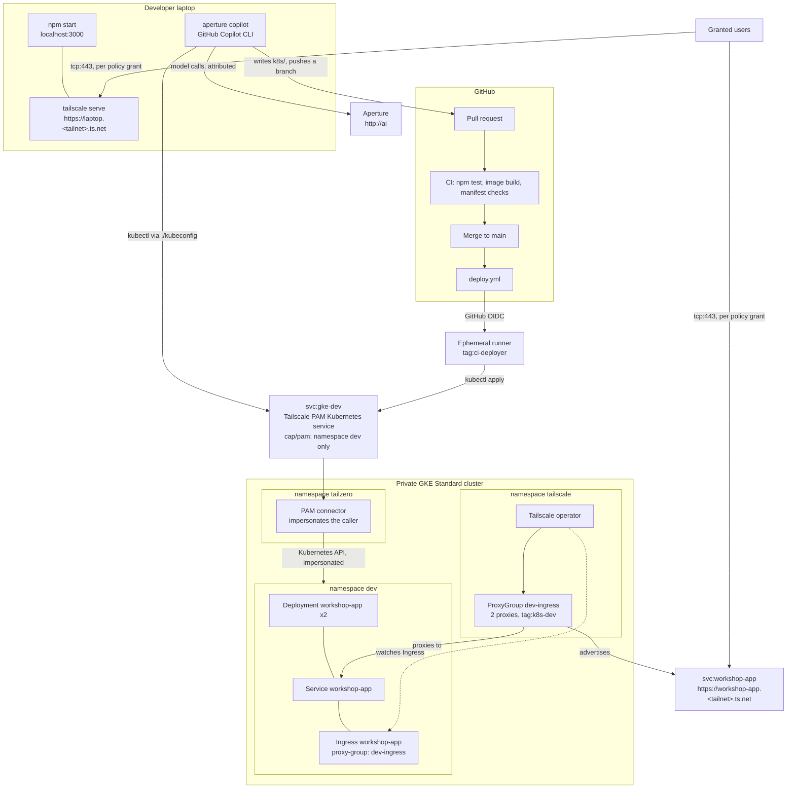

# Agentic-Aided Deployment Beyond Localhost

A developer has a Node.js app running on their laptop. Their platform team provides one namespace in a private GKE cluster and a kubeconfig that reaches it only through Tailscale PAM. The developer's coding agent, GitHub Copilot CLI launched through the Aperture CLI, shares the app with the team from the laptop, then writes the Kubernetes manifests and pushes them for review. GitHub Actions deploys them through Tailscale PAM, and the Tailscale Kubernetes operator publishes the app on the tailnet.

The developer holds no Kubernetes credential, cloud credential, Tailscale auth key, or model API key. Tailscale identity is the credential at every step, and every access change is a pull request.

The repository has two parts:

- [**Set up the environment**](#set-up-the-environment): the platform team's work, done once before the walkthrough. Terraform builds the cluster, the operator, and Tailscale PAM, and the baseline policy is applied.
- [**Walkthrough**](#walkthrough): the developer's story, run against that environment.

## The story

1. **Localhost.** `npm start`. The app runs on the developer's laptop.
2. **Share it.** `aperture copilot` starts Copilot CLI with Aperture as its model gateway, so every model call is attributed to the developer's tailnet identity. Asked to share the app, Copilot runs `tailscale serve --bg 3000`, which publishes it at `https://<laptop>.<tailnet>.ts.net` as the developer's own device. Nobody else can open it yet.
3. **Let the team in.** A pull request to `policy/policy.hujson` adds the grant; merging applies it.
4. **Ship it with an agent.** The agent reads the platform contract, writes `k8s/`, checks the namespace through PAM, and pushes a branch.
5. **Deploy.** Merging the pull request runs `deploy.yml`. The runner joins the tailnet as an ephemeral `tag:ci-deployer` with GitHub OIDC and applies `k8s/` through the Tailscale PAM Kubernetes service `gke-dev`, which only allows namespace `dev`.
6. **On the tailnet.** The agent's `Ingress` is served by the operator's `dev-ingress` ProxyGroup as the Tailscale Service `svc:workshop-app`, at `https://workshop-app.<tailnet>.ts.net`, from two proxy replicas.
7. **Team access.** A second policy pull request grants the team the dev-cluster Service. Reverting it revokes access.

The app is plain Node.js and contains no Tailscale code. Reachability, identity, and access all come from the tailnet.

## Architecture



## Security boundaries

- The cluster's IP control-plane endpoint is disabled. The platform team uses the IAM-gated DNS endpoint; developers and CI reach the API only through the PAM service.
- The developer and CI hold Kubernetes `edit` in `dev` only, bound to the identities the connector impersonates: the developer's login and `tag:ci-deployer@service.border0.com`.
- The `tailscale.com/cap/pam` grant restricts Kubernetes requests to `namespaces: ["dev"]` before RBAC is evaluated.
- GitHub Actions logs in with GitHub OIDC. Each trust credential accepts only this repository and one workflow on one ref. No secret is stored in GitHub.
- Terraform signs in to Tailscale with workload identity federation: it exchanges the platform engineer's short-lived Google identity token for a Tailscale token. Its federated identity is tagged `tag:terraform` and holds only the scopes of the credentials it creates. No Tailscale API key or OAuth secret exists.
- The operator signs in with its Kubernetes ServiceAccount token through workload identity federation; it has no OAuth client secret.
- Copilot CLI runs in offline BYOK mode against Aperture. It needs no GitHub Copilot sign-in and no model key; Aperture authorizes the developer's tailnet identity.
- The app's identity card comes from `Tailscale-User-*` headers that Tailscale Serve and the operator's Ingress add. Neither the laptop nor the cluster exposes the app any other way.
- The policy grants roles, not people: the developer is any tailnet Admin, the team is any Member. The repository contains no login names.
- Tailscale Funnel is not used.

## What you need

- A tailnet where you are an Admin or Owner, with:
  - HTTPS certificates enabled (**DNS → HTTPS Certificates**).
  - Tailscale PAM enabled (**Settings → PAM**).
  - An Aperture instance tagged `tag:aperture`, reachable at `http://ai` (the launcher's default; any other hostname works with `--endpoint`).
  - A second user with the **Member** role (not Admin), for the access steps.
- A Google Cloud project with the GKE and Compute Engine APIs enabled. `gcloud auth login` and `gcloud auth application-default login` done with an account that can create clusters and networks.
- A GitHub account with Actions enabled.
- Node.js 24, `kubectl`, `terraform`, `gcloud`, and `python3` installed locally.
- The [Aperture launcher](https://github.com/tailscale/aperture-cli) v0.1.0 or later, and GitHub Copilot CLI:

  ```bash
  curl -fsSL https://raw.githubusercontent.com/tailscale/aperture-cli/main/install.sh | APERTURE_INSTALL_DIR=$HOME/.local/bin sh
  npm install -g @github/copilot
  ```

  Running `aperture` with no arguments and choosing **GitHub Copilot** also offers to install Copilot CLI. `which -a aperture` should list `$HOME/.local/bin/aperture` first, and `aperture --version` should report v0.1.0 or later.

## Set up the environment

The platform team does these steps once, in order, before the walkthrough.

### 1. Fork and clone

Select **Fork** on this repository's GitHub page, keep it public, then clone your fork. A public fork makes the container images `deploy.yml` pushes public too, so the cluster pulls them without credentials.

### 2. Apply the baseline policy

Open **Access controls** in the admin console and paste `policy/policy.hujson`. If the tailnet already has a policy, merge these sections into it instead, and remove any blanket `* → *` grant so default deny is visible. From now on, changes to the policy go through pull requests to `policy/policy.hujson`, which `.github/workflows/policy.yml` tests and applies.

### 3. Create the Terraform federated identity

Terraform signs in to Tailscale with your Google login instead of an API key. This prints a link to the admin console with the issuer, your Google account's subject, and gcloud's audience filled in:

```bash
gcloud auth print-identity-token | python3 -c 'import sys,json,base64; p=sys.stdin.read().split(".")[1]; c=json.loads(base64.urlsafe_b64decode(p+"="*(-len(p)%4))); print("https://console.tailscale.com/admin/settings/trust-credentials/add?issuer="+c["iss"]+"&sub="+c["sub"]+"&aud="+c["aud"])'
```

Open the link and complete the form:

- **Description:** `workshop terraform`.
- **Scopes:**
  - **Keys → Federated Keys**: write. Terraform creates the operator's and the workflows' federated identities.
  - **Keys → Auth Keys**, **Devices → Core**, **General → Services**: write. The operator's identity needs them, and an identity can only grant scopes it holds.
  - **General → Policy File**: write. The policy workflows' identities need it.
  - **General → Users**: read. Terraform binds every tailnet Owner and Admin to `edit` in `dev`.
- **Tags:** `tag:terraform`. The baseline policy makes it the owner of `tag:k8s-operator` and `tag:ci-deployer`, the tags Terraform assigns.

Select **Generate credential** and copy the **Client ID**. It is not a secret.

### 4. Create a PAM service-account token

On the [PAM settings page](https://console.tailscale.com/admin/settings/pam), under **Service accounts**, select **Add service account** with the **Member** role, then **Edit → Create token**. Tailscale PAM is managed through the [Border0 Terraform provider](https://tailscale.com/docs/privileged-access-management/how-to/manage-resources-terraform), and this token is its only credential.

### 5. Build the environment

```bash
cd infra
cp terraform.tfvars.example terraform.tfvars   # fill in the four values; .gitignore keeps this file out of git
export TAILSCALE_IDENTITY_TOKEN=$(gcloud auth print-identity-token)
terraform init
terraform apply -target=google_container_cluster.this -target=google_container_node_pool.this
terraform apply
```

`TAILSCALE_IDENTITY_TOKEN` is valid for an hour; export it again before a later run. The first apply creates the cluster so the Kubernetes and Helm providers have an endpoint. If it fails with `does not have enough resources available`, the zone is out of capacity: run it again. The second apply creates:

- **Network:** a VPC with Cloud NAT and a private GKE Standard cluster with two nodes. The Tailscale operator needs privileged pods, so GKE Autopilot does not work.
- **Tailscale operator:** a federated identity trusting the cluster's ServiceAccount issuer, the operator Helm release, and the `dev-ingress` ProxyGroup with two `tag:k8s-dev` proxies.
- **Tailscale PAM:** the connector, its token, and the Kubernetes service `gke-dev` with impersonation on.
- **Developer namespace:** `dev` and its `edit` RoleBinding for every tailnet Owner and Admin and `tag:ci-deployer`.
- **GitHub trust credentials:** three federated identities that let this repository's workflows log in with GitHub OIDC.

The apply prints `TS_DEPLOY_CLIENT_ID`, `TS_POLICY_TEST_CLIENT_ID`, and `TS_POLICY_APPLY_CLIENT_ID`. In your fork on GitHub, open **Settings → Secrets and variables → Actions → Variables** and add each one under that name. They are identifiers, not secrets: a token is issued only to a workflow in your fork whose OIDC claims match.

You should see `<name>-operator`, `dev-ingress-0`, `dev-ingress-1`, and the connector on the **Machines** page, and `svc:gke-dev` on the **Services** page.

### 6. Check developer access

From the repository root:

```bash
KUBECONFIG=./kubeconfig kubectl get pods
KUBECONFIG=./kubeconfig kubectl -n kube-system get pods
```

The first returns `No resources found in dev namespace.` The second fails with `no policy rule allows access ... in the "kube-system" namespace`: PAM refuses it before Kubernetes sees it. `./kubeconfig` contains no credentials; your Tailscale identity is the credential.

## Walkthrough

Everything from here is the developer's side, against the environment above.

### Step 1: Localhost

```bash
npm test
HOST=127.0.0.1 npm start
curl http://127.0.0.1:3000/health
```

You should see `{"status":"ok",...}`.

### Step 2: Share it with the team

Leave the app running. In another terminal, from the repository root, start GitHub Copilot CLI through Aperture:

```bash
aperture copilot
```

The launcher connects to Aperture at `http://ai`, lists the models Aperture offers, and starts Copilot CLI with the one you pick. Copilot needs no GitHub sign-in, no Copilot plan, and no model key: Aperture authorizes your tailnet identity, and every request appears in the Aperture dashboard under your name. To skip the menu, pass the model as `<provider>/<model>`, exactly as the menu lists it, for example `vercel/anthropic/claude-haiku-5.5`:

```bash
aperture copilot --model <provider>/<model>
aperture copilot --endpoint http://<aperture-hostname> --model <provider>/<model>
```

Everything after `--` goes to `copilot` unchanged. `aperture copilot --debug` prints the environment the launcher sets.

Prompt:

> My app is running on localhost:3000. Share it with my team on the tailnet using tailscale serve in the background, and give me the URL.

Copilot asks before each command it runs. It runs `tailscale serve --bg 3000` and prints `https://<laptop>.<tailnet>.ts.net`. Serve publishes the app as your device, under your identity: no tag, no auth key, and no change to the policy.

Open that URL from another of your devices. The identity card shows your name, because Serve adds the `Tailscale-User-*` headers to every request.

Now open it as the second user. The connection fails: the policy has no grant that lets another user reach your devices, so Tailscale drops the traffic before it reaches the laptop.

### Step 3: Let the team in

Access changes go through a pull request. Add this grant to `policy/policy.hujson`:

```diff
 "grants": [
+  {
+    "src": ["autogroup:member"],
+    "dst": ["autogroup:admin"],
+    "ip":  ["tcp:443"],
+  },
```

It lets every member of the tailnet reach HTTPS on the devices of its Admins, the developer role in this policy. The pull request runs the policy test; merging applies it. The second user reloads the URL and gets in, and the identity card shows their name, not yours.

### Step 4: Ship it with an agent

In the same Copilot session:

Prompt:

> Ship this app to my dev namespace, highly available and reachable on the tailnet. Follow the platform contract.

The agent reads `.github/copilot-instructions.md`, writes a `Deployment`, `Service`, and Tailscale `Ingress` like `docs/reference/workshop-app.yaml`, commits them on a branch, and pushes it. It can check the namespace with `KUBECONFIG=./kubeconfig kubectl get all`. Ask it to try `-n kube-system`; PAM refuses.

### Step 5: Deploy

Open the pull request from the link the push printed, and merge it after CI passes. CI runs the tests, builds the image, and checks `k8s/`. `deploy.yml` then:

1. Builds and pushes `ghcr.io/<owner>/<repo>:<sha>`.
2. Joins the tailnet as an ephemeral `tag:ci-deployer` with GitHub OIDC, using the official [Tailscale GitHub Action](https://github.com/tailscale/github-action).
3. Uses the same `./kubeconfig` the developer has.
4. Substitutes the image into every workload in `k8s/`, applies the manifests through PAM, and waits for the rollout.

The run's last step lists two `workshop-app` pods `Running` and the `workshop-app` Ingress.

### Step 6: The app on the tailnet

```bash
KUBECONFIG=./kubeconfig kubectl get ingress workshop-app
```

When `ADDRESS` shows `workshop-app.<tailnet>.ts.net`, open `https://workshop-app.<tailnet>.ts.net`. The operator created the Tailscale Service `svc:workshop-app`, and both `dev-ingress` proxies advertise it. The identity card shows you again, this time added by the operator's ingress proxy. Delete one of the app pods through `./kubeconfig` and keep reloading: the `Service` sends every request to the remaining replica.

### Step 7: Team access to the dev cluster

Before the change, the second user's connection to `https://workshop-app.<tailnet>.ts.net` fails. Tailscale drops the traffic before the app sees it, so there is no HTTP 403.

Open a pull request that widens the Service grant in `policy/policy.hujson` from admins to every member:

```diff
 {
-  "src": ["autogroup:admin"],
+  "src": ["autogroup:member"],
   "dst": ["svc:workshop-app", "tag:k8s-dev"],
   "ip":  ["tcp:443"],
 },
```

Merge it, and the second user gets in with their own identity. Revert it to revoke access; the app and cluster are untouched.

## Repository protection

Protect `main`: require pull requests, an approval, passing checks, and resolved conversations. Disable force pushes. Do not let the agent approve or merge its own change. Pin third-party actions to full commit SHAs before using this outside a workshop.

## Cleanup

```bash
tailscale serve reset
terraform -chdir=infra destroy
```

Run the destroy with `TAILSCALE_IDENTITY_TOKEN` exported, as in step 5. It removes the cluster, the operator and its proxies, the PAM connector and service, `svc:workshop-app`, and the three GitHub trust credentials; a rebuild prints new client IDs for the repository variables. Remove any leftover `<name>*` machines from the tailnet, and delete the Terraform federated identity from step 3 when you are finished.

## Troubleshooting

### The Ingress never gets an address

- `KUBECONFIG=./kubeconfig kubectl describe ingress workshop-app` shows the operator's events.
- The `tailscale.com/proxy-group` annotation must be `dev-ingress`, and `ingressClassName` must be `tailscale`.
- The policy's `autoApprovers.services` must map `tag:k8s-dev` to `tag:k8s-dev`, and `tag:k8s-dev` must be owned by `tag:k8s-operator`.

### The ProxyGroup reports `requested tags [tag:k8s-dev] are invalid or not permitted`

The baseline policy was applied after the operator started. Apply it; the operator retries on its own.

### The Service resolves but connections time out

On some tailnets clients only receive a Service's hosts when a grant also names the hosts' tag. The grant therefore lists both `svc:workshop-app` and `tag:k8s-dev` on `tcp:443`.

### The second user is let in before the access pull request

They have the Admin role. The policy treats every Admin as the developer; give the second user the Member role.

### kubectl through PAM is refused

- `Forbidden` naming `tag:ci-deployer@service.border0.com` or your login: PAM let the request through, and RBAC refused it. Only tailnet Owners and Admins at the time of the last `terraform apply` are bound; run it again after a role change.
- `no policy rule allows access ... resource name "..."` inside `dev`: the `cap/pam` Kubernetes rule needs `"resource_names": ["*"]`.
- `failed to download openapi`: client-side validation reads the cluster-scoped `/openapi` path, which a namespace-scoped grant refuses. Apply with `--validate=false`, as `deploy.yml` does.
- Connection refused or timeout: the grant to `svc:gke-dev` is missing, or the device is not on the tailnet.

### A workflow fails with `federated identity invalid` or a 403

The client ID variable doesn't match a trust credential. Check the three variables against `terraform -chdir=infra output`, and that `github_repo` in `infra/terraform.tfvars` matches your fork's `owner/name` exactly, including capitalization.

### Terraform fails with `actor cannot set scopes` or `requested tags ... are invalid or not permitted`

The Terraform federated identity is missing a scope from step 3, or it is not tagged `tag:terraform`, or the baseline policy that makes `tag:terraform` an owner of `tag:k8s-operator` and `tag:ci-deployer` is not applied.
