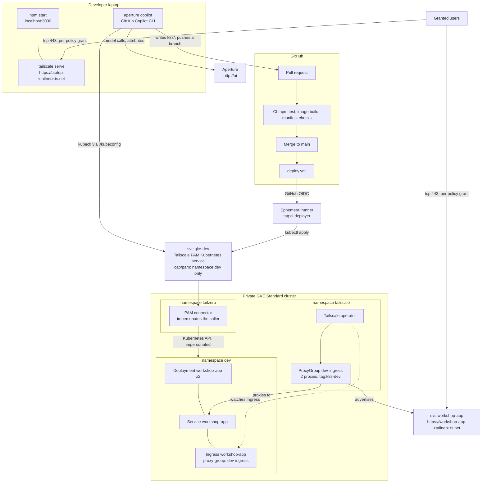

# Agentic-Aided Deployment Beyond Localhost

A developer has a small Node.js app that works on their laptop. They know nothing about Kubernetes. The platform team has given them one namespace in a private GKE cluster and a kubeconfig that reaches it only through Tailscale. Their agent, GitHub Copilot CLI launched through the Aperture CLI, writes the manifests and pushes them for review. GitHub Actions deploys them through Tailscale PAM, and the Tailscale Kubernetes operator puts the app on the tailnet.

Nobody in this story holds a Kubernetes credential, a cloud credential, a Tailscale auth key, or a model API key. Tailscale identity is the credential at every step, and every access change is a pull request.

## The story

1. **Localhost.** `npm start`. The app runs on the developer's laptop.
2. **Share it.** `tailscale serve --bg 3000` publishes it at `https://<laptop>.<tailnet>.ts.net`. A pull request to `policy/policy.hujson` lets the team in.
3. **Ship it with an agent.** `aperture copilot` starts Copilot CLI with Aperture as its model gateway, so every model call is attributed to the developer's tailnet identity. The agent reads the platform contract, writes `k8s/`, checks the namespace through PAM, and pushes a branch.
4. **Deploy.** Merging the pull request runs `deploy.yml`. The runner joins the tailnet as an ephemeral `tag:ci-deployer` with GitHub OIDC and applies `k8s/` through the Tailscale PAM Kubernetes service `gke-dev`, which only allows namespace `dev`.
5. **On the tailnet.** The agent's `Ingress` is served by the operator's `dev-ingress` ProxyGroup as the Tailscale Service `svc:workshop-app`, at `https://workshop-app.<tailnet>.ts.net`, from two proxy replicas.
6. **Team access.** A second policy pull request grants the team the dev-cluster Service. Reverting it revokes access.

The app is plain Node.js and contains no Tailscale code. Reachability, identity, and access all come from the tailnet.

## Architecture



## Security boundaries

- The cluster's IP control-plane endpoint is disabled. The platform team uses the IAM-gated DNS endpoint; developers and CI reach the API only through the PAM service.
- The developer and CI hold Kubernetes `edit` in `dev` only, bound to the identities the connector impersonates: the developer's login and `tag:ci-deployer@service.border0.com`.
- The `tailscale.com/cap/pam` grant restricts Kubernetes requests to `namespaces: ["dev"]` before RBAC is evaluated.
- GitHub Actions logs in with GitHub OIDC. Each trust credential accepts only this repository and one workflow on one ref. No secret is stored in GitHub.
- Copilot CLI runs in offline BYOK mode against Aperture. It needs no GitHub Copilot sign-in and no model key; Aperture authorizes the developer's tailnet identity.
- The app's identity card comes from `Tailscale-User-*` headers that Tailscale Serve and the operator's Ingress add. Neither the laptop nor the cluster exposes the app any other way.
- The policy grants roles, not people: the developer is any tailnet Admin, the team is any Member. The repository contains no login names.
- Tailscale Funnel is not used.

## What you need

- A tailnet where you are an Admin or Owner, with:
  - HTTPS certificates enabled (**DNS → HTTPS Certificates**).
  - Tailscale PAM enabled (**Settings → PAM**).
  - An Aperture instance tagged `tag:aperture`, reachable at `http://ai` (the launcher's default; any other hostname works with `--endpoint`).
  - A second user with the **Member** role (not Admin), for the access steps.
- A Google Cloud project with the GKE and Compute Engine APIs enabled, and `gcloud` logged in with permission to create clusters and networks.
- A GitHub account with Actions enabled.
- Node.js 24, `kubectl`, `terraform`, and `gcloud` installed locally.
- The [Aperture launcher](https://github.com/tailscale/aperture-cli) v0.1.0 or later, and GitHub Copilot CLI:

  ```bash
  curl -fsSL https://raw.githubusercontent.com/tailscale/aperture-cli/main/install.sh | APERTURE_INSTALL_DIR=$HOME/.local/bin sh
  npm install -g @github/copilot
  ```

  Running `aperture` with no arguments and choosing **GitHub Copilot** also offers to install Copilot CLI.

## Set up the platform

These steps play the platform team. Do them once, in order.

### 1. Fork and clone

Select **Fork** on this repository's GitHub page, keep it public, then clone your fork. A public fork makes the container images `deploy.yml` pushes public too, so the cluster pulls them without credentials.

### 2. Apply the baseline policy

Open **Access controls** in the admin console and paste `policy/policy.hujson`. If the tailnet already has a policy, merge these sections into it instead, and remove any blanket `* → *` grant so default deny is visible. From now on, changes to the policy go through pull requests to `policy/policy.hujson`, which `.github/workflows/policy.yml` tests and applies.

### 3. Create two admin credentials

Terraform reads them from the environment:

- `TAILSCALE_API_KEY`: an API access token (**Settings → Keys**).
- `BORDER0_TOKEN`: a Tailscale PAM service-account token. Under **Settings → PAM → Service accounts**, add a service account with the **Member** role, then create a token for it. Tailscale PAM is managed through the [Border0 Terraform provider](https://tailscale.com/docs/privileged-access-management/how-to/manage-resources-terraform).

```bash
export TAILSCALE_API_KEY=...
export BORDER0_TOKEN=...
```

### 4. Create the GitHub trust credentials (once)

`infra/bootstrap` creates three trust credentials that let this repository's workflows log in to the tailnet with GitHub OIDC. They live in their own Terraform state, so tearing down the cluster later does not change them.

```bash
cd infra/bootstrap
cp terraform.tfvars.example terraform.tfvars   # set github_repo to your fork, as owner/name
terraform init
terraform apply
```

It prints three client IDs. In your fork on GitHub, open **Settings → Secrets and variables → Actions → Variables** and add each one under the name it is printed with: `TS_DEPLOY_CLIENT_ID`, `TS_POLICY_TEST_CLIENT_ID`, and `TS_POLICY_APPLY_CLIENT_ID`. Client IDs are identifiers, not secrets: a token is issued only to a workflow in your fork whose OIDC claims match.

### 5. Build the cluster

```bash
cd ..
cp terraform.tfvars.example terraform.tfvars   # gcp_project and your login from the Users page
terraform init
terraform apply -target=google_container_cluster.this -target=google_container_node_pool.this
terraform apply
```

The first apply creates the cluster so the Kubernetes and Helm providers have an endpoint. If it fails with `does not have enough resources available`, the zone is out of capacity: run it again. The second apply creates:

- **Network:** a VPC with Cloud NAT and a private GKE Standard cluster with two nodes. The Tailscale operator needs privileged pods, so GKE Autopilot does not work.
- **Tailscale operator:** an OAuth client tagged `tag:k8s-operator`, the operator Helm release, and the `dev-ingress` ProxyGroup with two `tag:k8s-dev` proxies.
- **Tailscale PAM:** the connector, its token, and the Kubernetes service `gke-dev` with impersonation on. The connector exchanges its token for its own Tailscale auth key.
- **Developer namespace:** `dev` and its `edit` RoleBinding for your login and `tag:ci-deployer`.

Keep the default `name` unless you share the GCP project with others; it prefixes the cluster, network, and connector.

You should see `<name>-operator`, `dev-ingress-0`, `dev-ingress-1`, and the connector on the **Machines** page, and `svc:gke-dev` on the **Services** page.

### 6. Check developer access

From the repository root:

```bash
KUBECONFIG=./kubeconfig kubectl get pods
KUBECONFIG=./kubeconfig kubectl -n kube-system get pods
```

The first returns `No resources found in dev namespace.` The second fails with `no policy rule allows access ... in the "kube-system" namespace`: PAM refuses it before Kubernetes sees it. `./kubeconfig` contains no credentials; your Tailscale identity is the credential.

## Run the story

### Step 1: Localhost

```bash
npm test
HOST=127.0.0.1 npm start
curl http://127.0.0.1:3000/health
```

You should see `{"status":"ok",...}`.

### Step 2: Share it with tailscale serve

In another terminal:

```bash
tailscale serve --bg 3000
tailscale serve status
```

Open the `https://<laptop>.<tailnet>.ts.net` address it prints, from another of your devices. The identity card shows your name: Serve adds the `Tailscale-User-*` headers. The second user can't connect.

To let the team in, open a pull request that adds this grant to `policy/policy.hujson`:

```diff
 "grants": [
+  {
+    "src": ["autogroup:member"],
+    "dst": ["autogroup:admin"],
+    "ip":  ["tcp:443"],
+  },
```

The pull request runs the policy test; merging applies it, and the second user gets in with their own identity.

### Step 3: Ship it with an agent

From the repository root:

```bash
aperture copilot
```

The launcher connects to Aperture at `http://ai`, lists the models Aperture offers, and starts Copilot CLI pointed at the one you pick. Copilot needs no GitHub sign-in, no Copilot plan, and no model key. Every request appears in the Aperture dashboard under your tailnet identity. To skip the menu:

```bash
aperture copilot --model anthropic/claude-sonnet-5.5
aperture copilot --endpoint http://<aperture-hostname> --model anthropic/claude-sonnet-5.5
```

Everything after `--` goes to `copilot` unchanged. `aperture copilot --debug` prints the environment the launcher sets.

Prompt:

> Ship this app to my dev namespace, highly available and reachable on the tailnet. Follow the platform contract.

The agent reads `.github/copilot-instructions.md`, writes a `Deployment`, `Service`, and Tailscale `Ingress` like `docs/reference/workshop-app.yaml`, commits them on a branch, and pushes it. It can check the namespace with `KUBECONFIG=./kubeconfig kubectl get all`. Ask it to try `-n kube-system`; PAM refuses.

### Step 4: Deploy

Open the pull request from the link the push printed, and merge it after CI passes. CI runs the tests, builds the image, and checks `k8s/`. `deploy.yml` then:

1. Builds and pushes `ghcr.io/<owner>/<repo>:<sha>`.
2. Joins the tailnet as an ephemeral `tag:ci-deployer` with GitHub OIDC, using the official [Tailscale GitHub Action](https://github.com/tailscale/github-action).
3. Uses the same `./kubeconfig` the developer has.
4. Substitutes the image into every workload in `k8s/`, applies the manifests through PAM, and waits for the rollout.

The run's last step lists two `workshop-app` pods `Running` and the `workshop-app` Ingress.

### Step 5: The app on the tailnet

```bash
KUBECONFIG=./kubeconfig kubectl get ingress workshop-app
```

When `ADDRESS` shows `workshop-app.<tailnet>.ts.net`, open `https://workshop-app.<tailnet>.ts.net`. The operator created the Tailscale Service `svc:workshop-app`, and both `dev-ingress` proxies advertise it. The identity card shows you again, this time added by the operator's ingress proxy. Delete one of the app pods through `./kubeconfig` and keep reloading: the `Service` sends every request to the remaining replica.

### Step 6: Team access to the dev cluster

Before the change, the second user's connection to `https://workshop-app.<tailnet>.ts.net` fails. Tailscale drops the traffic before the app sees it, so there is no HTTP 403.

Open a pull request that widens the Service grant in `policy/policy.hujson` from admins to every member:

```diff
 {
-  "src": ["autogroup:admin"],
+  "src": ["autogroup:member"],
   "dst": ["svc:workshop-app", "tag:k8s-dev"],
   "ip":  ["tcp:443"],
 },
```

Merge it, and the second user gets in with their own identity. Revert it to revoke access; the app and cluster are untouched.

## Repository protection

Protect `main`: require pull requests, an approval, passing checks, and resolved conversations. Disable force pushes. Do not let the agent approve or merge its own change. Pin third-party actions to full commit SHAs before using this outside a workshop.

## Cleanup

```bash
tailscale serve reset
terraform -chdir=infra destroy
```

This removes the cluster, the operator and its proxies, the PAM connector and service, and `svc:workshop-app`. Remove any leftover `<name>*` machines from the tailnet. The trust credentials in `infra/bootstrap` stay, so the GitHub variables keep working for the next rebuild; run `terraform -chdir=infra/bootstrap destroy` only when you are finished with the workshop.

## Troubleshooting

### The Ingress never gets an address

- `KUBECONFIG=./kubeconfig kubectl describe ingress workshop-app` shows the operator's events.
- The `tailscale.com/proxy-group` annotation must be `dev-ingress`, and `ingressClassName` must be `tailscale`.
- The policy's `autoApprovers.services` must map `tag:k8s-dev` to `tag:k8s-dev`, and `tag:k8s-dev` must be owned by `tag:k8s-operator`.

### The ProxyGroup reports `requested tags [tag:k8s-dev] are invalid or not permitted`

The baseline policy was applied after the operator started. Apply it; the operator retries on its own.

### The laptop's Serve URL fails with a TLS handshake error

Open it from a different device. On one tested macOS client build, the laptop could not reach its own Serve URL over HTTPS (`tls alert handshake failure`), while other devices on the tailnet reached it normally.

### The Service resolves but connections time out

On some tailnets clients only receive a Service's hosts when a grant also names the hosts' tag. The grant therefore lists both `svc:workshop-app` and `tag:k8s-dev` on `tcp:443`.

### The second user is let in before the access pull request

They have the Admin role. The policy treats every Admin as the developer; give the second user the Member role.

### kubectl through PAM is refused

- `Forbidden` naming `tag:ci-deployer@service.border0.com` or your login: PAM let the request through, and RBAC refused it. Check `developer_login` in `infra/terraform.tfvars` matches your login on the **Users** page.
- `no policy rule allows access ... resource name "..."` inside `dev`: the `cap/pam` Kubernetes rule needs `"resource_names": ["*"]`.
- `failed to download openapi`: client-side validation reads the cluster-scoped `/openapi` path, which a namespace-scoped grant refuses. Apply with `--validate=false`, as `deploy.yml` does.
- Connection refused or timeout: the grant to `svc:gke-dev` is missing, or the device is not on the tailnet.

### A workflow fails with `federated identity invalid` or a 403

The client ID variable doesn't match a trust credential. Check the three variables against `terraform -chdir=infra/bootstrap output`, and that `github_repo` in `infra/bootstrap/terraform.tfvars` matches your fork's `owner/name` exactly, including capitalization.
