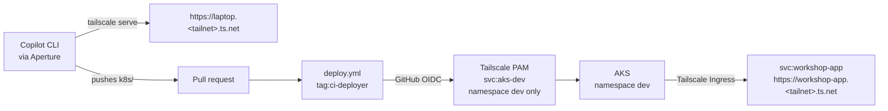

# Agentic-Aided Deployment Beyond Localhost

A coding agent shares a Node.js app from `localhost` with your team on the [tailnet](https://tailscale.com/docs/reference/glossary#tailnet) using [`tailscale serve`](https://tailscale.com/docs/features/tailscale-serve), then deploys it to an [AKS](https://learn.microsoft.com/en-us/azure/aks/what-is-aks) (Azure Kubernetes Service) cluster as a [Tailscale Service](https://tailscale.com/docs/features/tailscale-services). The developer holds no Kubernetes, cloud, Tailscale, or model credential. Tailscale identity is the credential, and every access change is a pull request.

## How it works



- **No standing credentials:** Terraform, the [Tailscale Kubernetes operator](https://tailscale.com/docs/kubernetes-operator) in the cluster, and GitHub Actions all sign in to Tailscale with [workload identity federation](https://tailscale.com/docs/features/workload-identity-federation) (no API keys or OAuth secrets).
- **Cluster access:** developers and CI never hold a cluster credential. A [Tailscale PAM](https://tailscale.com/docs/privileged-access-management) [connector](https://tailscale.com/docs/privileged-access-management/architecture-and-concepts#connectors) in the cluster proxies the Kubernetes API server as the [Kubernetes PAM service](https://tailscale.com/docs/privileged-access-management/how-to/access-kubernetes#create-a-kubernetes-pam-service) `svc:aks-dev`, and [impersonates](https://tailscale.com/docs/privileged-access-management/how-to/access-kubernetes#use-kubernetes-impersonation) each caller's tailnet identity. A `cap/pam` [grant](https://tailscale.com/docs/privileged-access-management/how-to/access-kubernetes#control-what-users-can-do-in-kubernetes) limits callers to namespace `dev`, where RBAC gives them `edit`.
- **Models:** Copilot CLI calls models through [Aperture](https://tailscale.com/docs/aperture) as your tailnet identity, with no Copilot sign-in and no model key.
- **Exposing the app from the cluster:** the agent writes a Kubernetes [`Ingress`](https://kubernetes.io/docs/concepts/services-networking/ingress/) with `ingressClassName: tailscale`. The operator serves it as a [layer 7 (HTTPS) ingress](https://tailscale.com/docs/kubernetes-operator/ingress#standalone-layer-7-ingress-for-http-and-https) in [high-availability mode](https://tailscale.com/docs/kubernetes-operator/ingress#high-availability-ha-ingress): two proxy replicas in the [ProxyGroup](https://tailscale.com/docs/kubernetes-operator/concepts/proxygroup) `dev-ingress` advertise one Tailscale Service, `svc:workshop-app`, with its own MagicDNS name and TLS certificate.
- **Identity headers:** the ingress proxies terminate HTTPS with Tailscale Serve, which adds [identity headers](https://tailscale.com/docs/features/tailscale-serve#identity-headers) (`Tailscale-User-Login`, `Tailscale-User-Name`) to every request. `tailscale serve` on the laptop adds the same headers. The app reads them to show who is calling, with no auth code of its own.
- **Who gets access:** [`policy/policy.hujson`](policy/policy.hujson) is the [tailnet policy file](https://tailscale.com/docs/features/tailnet-policy-file). Its grants never name a person. They use [autogroups](https://tailscale.com/docs/reference/targets-and-selectors#autogroups), built-in groups that Tailscale fills for you. [`autogroup:<role>`](https://tailscale.com/docs/reference/targets-and-selectors#autogrouprole) holds every user with that [user role](https://tailscale.com/docs/reference/user-roles): `autogroup:admin` (users with the [Admin](https://tailscale.com/docs/reference/user-roles#admin) role) is the developer, and `autogroup:member` (every user in the tailnet, with the [Member](https://tailscale.com/docs/reference/user-roles#member) role or any other) is the team. The policy works unchanged in any fork.

## What you need

- A tailnet where you are an [Admin or Owner](https://tailscale.com/docs/reference/user-roles), set up in the [admin console](https://console.tailscale.com/admin):
  - **HTTPS certificates:** on the [DNS](https://console.tailscale.com/admin/dns) page, under **HTTPS Certificates**, select **Enable HTTPS** ([docs](https://tailscale.com/docs/how-to/set-up-https-certificates)).
  - **Tailscale PAM:** PAM is in beta and must be [made available to your tailnet](https://tailscale.com/docs/privileged-access-management/get-started#prerequisites) before you can turn it on. To get access, [join the waitlist](https://tailscale.com/pam-selfserve-waitlist) to try it for free, or [contact Tailscale Sales](https://tailscale.com/contact/sales-border0). Once it's available, open the [PAM](https://console.tailscale.com/admin/settings/pam) settings page and select **Enable** ([docs](https://tailscale.com/docs/privileged-access-management/get-started#step-1-enable-the-tailscale-pam-integration-for-your-tailnet)).
  - **Aperture:** reachable at `http://ai` ([get started](https://tailscale.com/docs/aperture/get-started)). On the [Machines](https://console.tailscale.com/admin/machines) page, give the Aperture device the [tag](https://tailscale.com/docs/features/tags) `tag:aperture`. If the console won't offer the tag, first add `"tag:aperture": ["autogroup:admin"]` to `tagOwners` on the [Access controls](https://console.tailscale.com/admin/acls) page.
  - **A second user:** on the [Users](https://console.tailscale.com/admin/users) page, [invite](https://tailscale.com/docs/features/sharing/how-to/invite-team-members) a second person with the [**Member**](https://tailscale.com/docs/reference/user-roles#member) role.
- An Azure subscription where your account has the [**Contributor**](https://learn.microsoft.com/en-us/azure/role-based-access-control/built-in-roles/privileged#contributor) role ([check your roles](https://learn.microsoft.com/en-us/azure/role-based-access-control/role-assignments-list-portal))
- Installed locally: [Node.js](https://nodejs.org/en/download) 24, [`kubectl`](https://kubernetes.io/docs/tasks/tools/), [Terraform](https://developer.hashicorp.com/terraform/install), the [Azure CLI](https://learn.microsoft.com/en-us/cli/azure/install-azure-cli) (`az`), and the [GitHub CLI](https://cli.github.com/) (`gh`), signed in with [`gh auth login`](https://cli.github.com/manual/gh_auth_login)
- The [Aperture CLI](https://tailscale.com/docs/aperture/cli) v0.1.0 or later. Install it from a [release](https://github.com/tailscale/aperture-cli/releases) or with one of the methods in its [installation instructions](https://github.com/tailscale/aperture-cli#installation). `aperture --version` prints the version.
- [GitHub Copilot CLI](https://docs.github.com/en/copilot/how-tos/set-up/install-copilot-cli#installing-or-updating-copilot-cli), installed with one of the methods GitHub documents.

## How to use this repository

1. [Fork this repository](https://docs.github.com/en/pull-requests/collaborating-with-pull-requests/working-with-forks/fork-a-repo), then follow [**Setup**](#setup) in your fork to build the infrastructure the demo runs on.
2. Follow the [**Walkthrough**](#walkthrough): the demo itself, the developer experience from `localhost` to the cluster.

## Setup

### 1. Fork and clone

[Fork this repository](https://docs.github.com/en/pull-requests/collaborating-with-pull-requests/working-with-forks/fork-a-repo) and clone your fork. Keep the fork public so the steps work as written: the cluster pulls the app image from the [GitHub Container Registry](https://docs.github.com/en/packages/working-with-a-github-packages-registry/working-with-the-container-registry) without credentials. A private fork needs an [image pull secret](https://kubernetes.io/docs/tasks/configure-pod-container/pull-image-private-registry/), which this repository doesn't set up.

### 2. Add the tag owners

Open [Access controls](https://console.tailscale.com/admin/acls) in the admin console and add these entries to your [tailnet policy file](https://tailscale.com/docs/reference/syntax/policy-file). Merge them into existing [`tagOwners`](https://tailscale.com/docs/reference/syntax/policy-file#tag-owners) and [`autoApprovers`](https://tailscale.com/docs/reference/syntax/policy-file#autoapprovers) sections if you have them. Leave everything else as it is.

```jsonc
"tagOwners": {
  "tag:terraform":       ["autogroup:admin"],
  "tag:ci-deployer":     ["autogroup:admin", "tag:terraform"],
  "tag:k8s-operator":    ["autogroup:admin", "tag:terraform"],
  "tag:k8s-dev":         ["tag:k8s-operator"],
  "tag:aperture":        ["autogroup:admin"],
},
"autoApprovers": {
  "services": {
    "tag:k8s-dev": ["tag:k8s-dev"],
  },
},
```

- **`tagOwners`** decides who may apply each [tag](https://tailscale.com/docs/features/tags). Terraform's credential is `tag:terraform`, and it assigns `tag:ci-deployer` and `tag:k8s-operator`, so those tags must exist first.
- **`autoApprovers.services`** maps a Service's tag to the device tags allowed to host it. `svc:workshop-app` is tagged `tag:k8s-dev`, and so are the proxies that serve it, so the operator's [Tailscale Services](https://tailscale.com/docs/features/tailscale-services) are approved without a manual step.
- Enabling PAM already added the `tag:border0-managed` entries that the PAM connector and `svc:aks-dev` need.

Step 5 replaces the rest of the policy.

### 3. Create the Terraform credential

Terraform signs in to Tailscale with a [trust credential](https://tailscale.com/docs/reference/trust-credentials) that accepts your Azure login through [workload identity federation](https://tailscale.com/docs/features/workload-identity-federation), so there is no Tailscale API key.

1. [Sign in to Azure](https://learn.microsoft.com/en-us/cli/azure/authenticate-azure-cli-interactively):

   ```bash
   az login
   ```

2. Print the form link and your Entra [object ID](https://learn.microsoft.com/en-us/entra/identity-platform/access-token-claims-reference) (`oid`):

   ```bash
   echo "https://console.tailscale.com/admin/settings/trust-credentials/add?issuer=https://sts.windows.net/$(az account show --query tenantId -o tsv)/&sub=*&aud=https://management.azure.com"
   echo "oid: $(az ad signed-in-user show --query id -o tsv)"
   ```

   Example output:

   ```
   https://console.tailscale.com/admin/settings/trust-credentials/add?issuer=https://sts.windows.net/aaaaaaaa-bbbb-cccc-dddd-eeeeeeeeeeee/&sub=*&aud=https://management.azure.com
   oid: 3f2a8c1e-5b7d-4e9a-a6c2-9d0e1f4b7a55
   ```

3. Open the link. Issuer, subject, and audience are filled in. Set:

   | Field | Value |
   |---|---|
   | Description | `Agentic workshop Terraform` |
   | [Scopes](https://tailscale.com/docs/reference/trust-credentials#scopes), write | **Federated Keys**, **Auth Keys**, **Devices → Core**, **Services**, **Policy File** |
   | [Scopes](https://tailscale.com/docs/reference/trust-credentials#scopes), read | **Users** |
   | Tags | `tag:terraform` |

   Under **Custom claims**, select **Add claim key** and fill in the two boxes. With the example output above:

   | Key | Value |
   |---|---|
   | `oid` | `3f2a8c1e-5b7d-4e9a-a6c2-9d0e1f4b7a55` |

   Use your own ID from the `oid:` line, not the example.

4. Select **Generate credential** and copy the **Client ID**.

### 4. Create a PAM token

Terraform manages Tailscale PAM through the [Border0 Terraform provider](https://tailscale.com/docs/privileged-access-management/how-to/manage-resources-terraform), which signs in with a service-account token. On [Settings → PAM](https://console.tailscale.com/admin/settings/pam), go to **Service accounts**:

1. Select **Add service account** with the **Member** role.
2. Select **Edit → Create token**, and copy the token.

### 5. Build the environment

1. Copy the example, then fill in the four values in [`infra/terraform.tfvars`](https://developer.hashicorp.com/terraform/language/values/variables#variable-definitions-tfvars-files). The comments in the file say where each value comes from.

   `border0_token` is a secret, and your fork is public. [`.gitignore`](.gitignore) lists `*.tfvars` and `*.tfstate*`, so [`git add` skips them](https://git-scm.com/docs/gitignore) and the token stays out of your commits. The state files are excluded too, because Terraform writes [secrets into state](https://developer.hashicorp.com/terraform/language/manage-sensitive-data), including the PAM connector token and the cluster's client certificate. Keep both files on your machine only.

   ```bash
   cd infra
   cp terraform.tfvars.example terraform.tfvars
   ```

2. Run [`terraform apply`](https://developer.hashicorp.com/terraform/cli/commands/apply) twice. The first run creates the cluster; the second creates everything on it: the [Tailscale Kubernetes operator](https://tailscale.com/docs/kubernetes-operator), the PAM connector and `svc:aks-dev`, the `dev` namespace, and three trust credentials for GitHub Actions.

   ```bash
   export TAILSCALE_IDENTITY_TOKEN=$(az account get-access-token --resource https://management.azure.com --query accessToken -o tsv)
   terraform init
   terraform apply -target=azurerm_kubernetes_cluster.this
   terraform apply
   ```

   The `export` line is how Terraform signs in to Tailscale without an API key:

   - [`az account get-access-token`](https://learn.microsoft.com/en-us/cli/azure/account#az-account-get-access-token) prints a short-lived Entra ID token for your Azure login. Its issuer, audience, and `oid` match the credential from step 3.
   - The [Tailscale Terraform provider](https://registry.terraform.io/providers/tailscale/tailscale/latest/docs) reads `TAILSCALE_IDENTITY_TOKEN` and exchanges it, together with `tailscale_client_id`, for a Tailscale API token scoped to that credential.

   The Entra token expires after about an hour. Run the `export` line again before any later `terraform` command.

3. Add the three outputs as [repository variables](https://docs.github.com/en/actions/how-tos/write-workflows/choose-what-workflows-do/use-variables) with [`gh variable set`](https://cli.github.com/manual/gh_variable_set). They are client IDs, not secrets: GitHub Actions exchanges its [OIDC token](https://docs.github.com/en/actions/concepts/security/openid-connect) for a Tailscale token with them.

   ```bash
   for v in TS_DEPLOY_CLIENT_ID TS_POLICY_TEST_CLIENT_ID TS_POLICY_APPLY_CLIENT_ID; do
     gh variable set $v -b "$(terraform output -raw $v)"
   done
   ```

4. Apply the full policy with [`gh workflow run`](https://cli.github.com/manual/gh_workflow_run). It **replaces** your tailnet policy, so first add anything else your tailnet needs to [`policy/policy.hujson`](policy/policy.hujson).

   ```bash
   gh workflow run policy.yml --ref main
   ```

   From now on, change the policy with pull requests to `policy/policy.hujson`. [`.github/workflows/policy.yml`](.github/workflows/policy.yml) tests each pull request and applies it on merge.

You should see these in the admin console:

- [**Machines**](https://console.tailscale.com/admin/machines): `<name>-operator`, `dev-ingress-0`, `dev-ingress-1`, `<name>`
- [**Services**](https://console.tailscale.com/admin/services): `svc:aks-dev`

### 6. Add the cluster context and check access

1. Add an `aks-dev` [context](https://kubernetes.io/docs/concepts/configuration/organize-cluster-access-kubeconfig/#context) that points at the PAM service, and switch to it:

   ```bash
   kubectl config set-cluster aks-dev --server=http://aks-dev
   kubectl config set-context aks-dev --cluster=aks-dev --namespace=dev
   kubectl config use-context aks-dev
   ```

   The context has no token, certificate, or password, because the tailnet already knows who you are. A `kubectl` request travels like this:

   1. `kubectl` sends it to `http://aks-dev` over the tailnet. Tailscale encrypts the connection end to end, so plain HTTP is safe here.
   2. The PAM [connector](https://tailscale.com/docs/privileged-access-management/architecture-and-concepts#connectors) behind `svc:aks-dev` sees which tailnet user or tagged device opened the connection.
   3. The connector checks the `cap/pam` grant in your policy, which allows only namespace `dev` ([details](https://tailscale.com/docs/privileged-access-management/how-to/access-kubernetes#control-what-users-can-do-in-kubernetes)).
   4. It forwards the request to the Kubernetes API with its own in-cluster identity and [impersonates](https://tailscale.com/docs/privileged-access-management/how-to/access-kubernetes#use-kubernetes-impersonation) you with `Impersonate-User: <your login>`. Kubernetes [RBAC](https://kubernetes.io/docs/reference/access-authn-authz/rbac/) then applies the `edit` role Terraform bound to your login in `dev`.

   So there is nothing on your laptop to leak, rotate, or revoke. Removing the grant removes access.

2. Check access:

   ```bash
   kubectl get pods                  # No resources found in dev namespace.
   kubectl -n kube-system get pods   # Forbidden: no policy rule allows access
   ```

## Walkthrough

### 1. Run it locally

From the repository root:

```bash
npm test
HOST=127.0.0.1 npm start
```

`curl http://127.0.0.1:3000/health` returns `{"status":"ok",...}`.

### 2. Share it

In a second terminal, from the repository root:

```bash
aperture copilot
```

The [Aperture CLI](https://tailscale.com/docs/aperture/cli) points Copilot CLI at Aperture, so Copilot needs no GitHub sign-in or model key. Pick a model from the menu. To skip the menu, pass the model as `--model <provider>/<model>`, for example `--model vercel/anthropic/claude-haiku-5.5`.

Prompt:

> My app is running on localhost:3000. Share it with my team on the tailnet using tailscale serve in the background, and give me the URL.

Copilot runs [`tailscale serve --bg 3000`](https://tailscale.com/docs/reference/tailscale-cli#serve) and prints `https://<laptop>.<tailnet>.ts.net`.

- **You:** open the URL. The page lists each [identity header](https://tailscale.com/docs/features/tailscale-serve#identity-headers) Serve added, with your login, name, and profile picture.
- **Second user:** the connection fails. No [grant](https://tailscale.com/docs/features/access-control/grants) lets them reach your devices yet.

### 3. Let the team in

In the same Copilot session:

> Let my team open the app I'm sharing. Open a pull request for the policy change.

Copilot edits [`policy/policy.hujson`](policy/policy.hujson) and opens the pull request with [`gh pr create`](https://cli.github.com/manual/gh_pr_create). The rule it follows is in [`.github/copilot-instructions.md`](.github/copilot-instructions.md). Review the change. It should add one grant:

```diff
 "grants": [
+  {
+    "src": ["autogroup:member"],
+    "dst": ["autogroup:admin"],
+    "ip":  ["tcp:443"],
+  },
```

The pull request runs the policy test. Merge it, and `policy.yml` applies it. The second user reloads the URL and sees their own name.

### 4. Ship it

In the same Copilot session:

> Ship this app to my dev namespace, highly available and reachable on the tailnet. Follow the platform contract.

The agent follows [`.github/copilot-instructions.md`](.github/copilot-instructions.md), the [repository instructions](https://docs.github.com/en/copilot/how-tos/configure-custom-instructions/add-repository-instructions) Copilot reads. It writes `k8s/` (a [`Deployment`](https://kubernetes.io/docs/concepts/workloads/controllers/deployment/), a [`Service`](https://kubernetes.io/docs/concepts/services-networking/service/), and a Tailscale [`Ingress`](https://tailscale.com/docs/kubernetes-operator/ingress)), then opens a pull request. To see PAM refuse it, ask it to run `kubectl -n kube-system get pods`.

### 5. Deploy

Review the pull request Copilot opened, and merge it when CI passes. [`deploy.yml`](.github/workflows/deploy.yml) takes three steps:

1. Builds `ghcr.io/<owner>/<repo>:<sha>` and pushes it to the [GitHub Container Registry](https://docs.github.com/en/packages/working-with-a-github-packages-registry/working-with-the-container-registry).
2. Joins the tailnet as an [ephemeral](https://tailscale.com/docs/features/ephemeral-nodes) `tag:ci-deployer` device with the [Tailscale GitHub Action](https://github.com/tailscale/github-action), signing in with [GitHub OIDC](https://docs.github.com/en/actions/concepts/security/openid-connect).
3. Applies `k8s/` through PAM with [`./kubeconfig`](kubeconfig), which has the same `aks-dev` context.

The run ends with two `workshop-app` [pods](https://kubernetes.io/docs/concepts/workloads/pods/) `Running`.

### 6. Open it

```bash
kubectl get ingress workshop-app
```

When `ADDRESS` shows `workshop-app.<tailnet>.ts.net`, the [MagicDNS](https://tailscale.com/docs/features/magicdns) name of `svc:workshop-app`, open `https://workshop-app.<tailnet>.ts.net`. Delete a pod and keep reloading: the other replica keeps serving.

### 7. Give the team the cluster app

Today the second user's connection fails. In the Copilot session:

> Let my team open the app in the cluster too. Open a pull request for the policy change.

Review the change. It should widen one grant:

```diff
 {
-  "src": ["autogroup:admin"],
+  "src": ["autogroup:member"],
   "dst": ["svc:workshop-app", "tag:k8s-dev"],
   "ip":  ["tcp:443"],
 },
```

Merge it, and they get in. Revert it to revoke access.

## Cleanup

From the repository root, with `TAILSCALE_IDENTITY_TOKEN` exported:

```bash
tailscale serve reset
terraform -chdir=infra destroy
```

Then, in the admin console:

1. On [Machines](https://console.tailscale.com/admin/machines), delete any leftover `<name>*` devices.
2. On [Trust credentials](https://console.tailscale.com/admin/settings/trust-credentials), delete the step 3 credential.

## Repository protection

- [Protect `main`](https://docs.github.com/en/repositories/configuring-branches-and-merges-in-your-repository/managing-protected-branches/about-protected-branches): require pull requests, an approval, and passing checks.
- Don't let the agent approve or merge its own pull requests.
- Before using this outside a workshop, [pin third-party actions to commit SHAs](https://docs.github.com/en/actions/reference/security/secure-use#using-third-party-actions).

## Troubleshooting

| Symptom | Fix |
|---|---|
| Terraform: `actor cannot set scopes` | The step 3 credential is missing a scope. |
| Terraform or ProxyGroup: `requested tags ... are invalid or not permitted` | The step 2 tag owners are missing, or the credential isn't tagged `tag:terraform`. |
| Terraform: `federated identity invalid` | Wrong `tailscale_client_id`, or the `oid` claim isn't your login. |
| Workflow: `federated identity invalid` or 403 | Repository variables don't match `terraform -chdir=infra output`, or `github_repo` doesn't match your fork exactly. |
| `kubectl`: `Forbidden` naming your login | Kubernetes [RBAC](https://kubernetes.io/docs/reference/access-authn-authz/rbac/) refused it. Terraform binds Admins and Owners at apply time, so if you became Admin later, run `terraform apply` again. |
| `kubectl`: connection refused or timeout | The grant to `svc:aks-dev` is missing, or this device isn't on the tailnet. |
| Ingress never gets an address | Check `kubectl describe ingress workshop-app`. The annotation `tailscale.com/proxy-group` must be `dev-ingress`, the [ProxyGroup](https://tailscale.com/docs/kubernetes-operator/concepts/proxygroup). |
| Second user gets in before step 3 | They're an [Admin](https://tailscale.com/docs/reference/user-roles#admin). Make them a [Member](https://tailscale.com/docs/reference/user-roles#member). |
